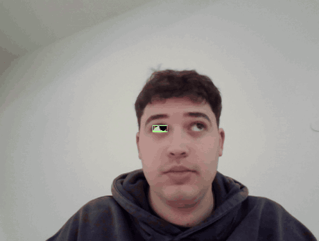

# eyeView

A C++ webcam eye tracker I'm building with OpenCV and Dlib. The idea is to go from basic face detection all the way to estimating where I'm looking on the screen.



Live Dlib eye ROI tracking with binary thresholding applied in-place on the eye region so the dark pupil stands out from the sclera.

## What I've got so far

Started with OpenCV Haar cascades just to get the basics down (notes in [JOURNAL.md](JOURNAL.md)), then moved to Dlib's 68-point facial landmark model since Haar was too noisy.

Right now `src/main.cpp` does this in real time:
- Detects the face and pulls the 6 eye landmarks (points 36-41) to get the eye center and crop a tight ROI around it.
- Converts that crop to grayscale, applies an inverse binary threshold (`100`), and uses `cv::moments` to find the center of mass of the dark area (the pupil).
- Computes a normalized offset (`NormX`, `NormY`) from the eye center to the pupil relative to half the eye box size, prints it to the terminal, and draws the vector on the feed.

Earlier tests like blink detection with EAR (Eye Aspect Ratio) are also in `src/main.cpp`, commented out while I work on the gaze vector.

## What's still missing

- Only tracks one eye right now.
- The binary threshold is hardcoded to `100`, so lighting changes, shadows, or eyelashes inside the box throw off the pupil center pretty easily.
- No smoothing yet, so the vector jitters from frame to frame.
- Blink detection isn't hooked into the main loop, so blinking sends garbage coordinates.
- Outputs raw normalized offsets (`NormX`, `NormY`) instead of screen `(x, y)` coordinates, and moving your head messes up the values.

## Next steps

1. **Better pupil detection**  
   Mask the eye ROI to the 6-landmark polygon instead of a rectangle so eyelashes and eyebrows don't skew `cv::moments`. Swap the hardcoded `100` threshold for adaptive thresholding (or Otsu) plus basic contour filtering, track both eyes, hook EAR blink filtering back in, and add smoothing (moving average or Kalman filter) to kill the jitter.

2. **Calibration**  
   Add a 5-point or 9-point calibration step where I look at targets on screen and record average `(NormX, NormY)` readings, then fit a mapping (like polynomial regression) to turn them into screen coordinates. Later on I also need to account for head movement.

3. **Evaluating accuracy**  
   Test the calibrated tracker against fixed targets across the screen and measure the actual error (pixels and degrees) plus fixation jitter under different lighting and distances, so I can tell if changes to the pupil detector actually help.

## Building and running

Needs CMake (3.16+), a C++17 compiler, OpenCV, Dlib (with BLAS/LAPACK), and a webcam.

```bash
cmake -B build
cmake --build build
./build/eyeView
```

Run it from the repo root so it can find `models/shape_predictor_68_face_landmarks.dat`. Press `q` to close.
